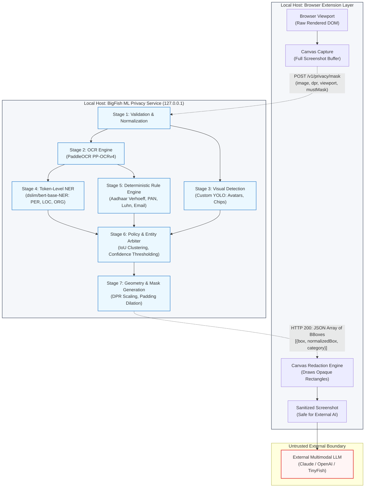

# BigFish ML Privacy Service

> **Local Computer Vision & NLP Privacy Pipeline for Autonomous Browser Screenshot Masking**  
> *Component Directory:* `BigFish/ML/`  
> *Package Version:* `0.1.0` (SemVer: `0.1.0`)  
> *Current State:* **Foundational Scaffold / Target Architecture Specification**

---

## Table of Contents

- [Overview & The "Why"](#overview--the-why)
  - [The Problem](#the-problem)
  - [The Solution](#the-solution)
  - [Core Privacy Proposition](#core-privacy-proposition)
- [Built Features & Current State](#built-features--current-state)
  - [Implementation Reality Matrix](#implementation-reality-matrix)
  - [Active Workspace Artifacts](#active-workspace-artifacts)
- [Architecture & Design Patterns](#architecture--design-patterns)
  - [Trust Boundary & Pipeline Diagram](#trust-boundary--pipeline-diagram)
  - [Detailed Pipeline Stages](#detailed-pipeline-stages)
    - [Stage 1: Image Input & Validation](#stage-1-image-input--validation)
    - [Stage 2: Optical Character Recognition (PaddleOCR)](#stage-2-optical-character-recognition-paddleocr)
    - [Stage 3: Visual Object Detection (YOLO)](#stage-3-visual-object-detection-yolo)
    - [Stage 4: Named-Entity Recognition (dslim/bert-base-NER)](#stage-4-named-entity-recognition-dslimbert-base-ner)
    - [Stage 5: Rule-Based Sensitive Data Detection](#stage-5-rule-based-sensitive-data-detection)
    - [Stage 6: Entity Resolution & Privacy Policy Arbiter](#stage-6-entity-resolution--privacy-policy-arbiter)
    - [Stage 7: Mask-Region Generation & Geometry](#stage-7-mask-region-generation--geometry)
    - [Stage 8: Screenshot Sanitization & Caller Boundary](#stage-8-screenshot-sanitization--caller-boundary)
  - [Edge Cases & Reliability Matrix](#edge-cases--reliability-matrix)
- [Communication & Contracts](#communication--contracts)
  - [Current Entry Point](#current-entry-point)
  - [Target Service Protocol](#target-service-protocol)
  - [Conceptual Request Contract](#conceptual-request-contract)
  - [Conceptual Response Contract](#conceptual-response-contract)
  - [Coordinate Space & Normalization Standards](#coordinate-space--normalization-standards)
  - [Data Sensitivity & Field Visibility](#data-sensitivity--field-visibility)
- [Usage & Setup](#usage--setup)
  - [Prerequisites](#prerequisites)
  - [Local Execution & Setup](#run-locally)
  - [Alternative Virtual Environment Setup](#alternative-virtual-environment-setup)
  - [Target Daemon Execution (Proposed)](#target-daemon-execution-proposed)
  - [Technology Stack & Dependencies](#technology-stack--dependencies)
  - [Hardware & Resource Profiles](#hardware--resource-profiles)
- [Production Readiness](#production-readiness)
  - [Local-Only Compute & Zero-Persistence Invariant](#local-only-compute--zero-persistence-invariant)
  - [Health Checks & Observability (/healthz and /ready)](#health-checks--observability-healthz-and-ready)
  - [Configuration Keys & Environment](#environment-variables)
  - [Zero-Leak Structured Logging](#zero-leak-structured-logging)
  - [Fail-Closed Security Posture](#fail-closed-security-posture)
  - [Performance & Cold-Start Latency Breakdown](#performance--cold-start-latency-breakdown)
- [Testing & Validation Strategy](#testing--validation-strategy)
  - [Current Test Coverage](#current-test-coverage)
  - [Target Test Suite Structure](#target-test-suite-structure)
  - [Key Synthetic Test Scenarios](#key-synthetic-test-scenarios)
  - [Reproducible Benchmark Protocol](#reproducible-benchmark-protocol)
- [Changelog & Migration State](#changelog--migration-state)
  - [Release 0.1.0](#release-010)
  - [Migration & Integration Notes](#migration--integration-notes)
- [Implementation Roadmap](#implementation-roadmap)

---

## Overview & The "Why"

### The Problem
Autonomous browser agents (such as those orchestrated across the BigFish ecosystem) capture viewport screenshots to perceive page state, inspect interactive elements, and verify task progress. However, live web pages routinely display high-risk sensitive data:
- **Personal Identifiable Information (PII):** Full names, phone numbers, home addresses, and personal email addresses.
- **National & Tax Identifiers:** Indian Aadhaar numbers, Permanent Account Numbers (PAN), and international social identification keys.
- **Financial & Payment Artifacts:** Credit card numbers, bank account balances, IFSC codes, and UPI IDs.
- **Visual & Biometric Data:** Facial profile photos, handwritten signatures, and high-entropy authentication QR codes.

Transmitting raw, unredacted screenshots to external Multimodal Large Language Models (LLMs) or third-party cloud inference providers creates severe regulatory liabilities (GDPR, DPDP Act 2023, HIPAA) and risks catastrophic credential or identity leakage.

### The Solution
The **BigFish ML Privacy Service** (`BigFish/ML/`) is designed as a standalone, lightweight, on-device perception engine that intercepts screenshots locally. By synthesizing optical character recognition (OCR), named-entity recognition (NER), computer vision object detection (YOLO), and deterministic pattern rules, the service identifies sensitive regions and outputs precise pixel bounding boxes. These coordinates allow the client (e.g., the BigFish browser extension) to apply visual redaction masks directly on the client canvas *before* any image buffer leaves the local host.

### Core Privacy Proposition
1. **100% On-Device Execution:** All inference runs on `127.0.0.1` or in-process IPC. Zero raw images or text strings are transmitted over the network.
2. **Context-Preserving Redaction:** Instead of blinding the agent with full-page blur, the service masks *only* the sensitive bounding boxes, preserving navigation headers, buttons, layout semantics, and surrounding instructions.
3. **Defense-in-Depth:** Combining transformer-based NLP with deterministic checksum validators (such as Verhoeff for Aadhaar and Luhn for payment cards) ensures high recall while mitigating false-positive degradation.

---

## Built Features & Current State

### Implementation Reality Matrix

To maintain rigorous technical transparency across the BigFish project, the following matrix distinguishes active code from planned architectural targets:

| Capability / Subsystem | Current State in `BigFish/ML/` | Implementation Notes |
|---|---|---|
| **Packaging & Python Tooling** | ✅ **Implemented** | Python `>=3.12` configured via `.python-version`, project metadata in `pyproject.toml`, lockfile in `uv.lock`. |
| **CLI Entry Point** | ✅ **Implemented (Scaffold)** | Minimal entry-point stub in `main.py` executing `main()` and printing startup status. |
| **PaddleOCR Pipeline** | 📋 *Planned (Roadmap)* | Target specification detailed in this README; no OCR model weights or code loaded yet. |
| **BERT-NER Pipeline** | 📋 *Planned (Roadmap)* | `dslim/bert-base-NER` pipeline and character-to-box projection specified; not yet instantiated. |
| **Visual YOLO Pipeline** | 📋 *Planned (Roadmap)* | Custom UI visual object classes specified; custom weights not yet trained or integrated. |
| **Indian PII & Regex Engine** | 📋 *Planned (Roadmap)* | Aadhaar Verhoeff, PAN, email, and phone validation algorithms specified; code to be ported. |
| **HTTP Daemon & Contracts** | 📋 *Planned (Roadmap)* | REST/JSON endpoints (`POST /v1/privacy/mask`) and schemas specified; daemon not yet active. |
| **Test Suite** | 📋 *Pending (0 Tests)* | No test files currently exist in `BigFish/ML/`. Comprehensive test strategy outlined below. |

### Active Workspace Artifacts
```
BigFish/ML/
├── .python-version    # Pinning Python 3.12 runtime
├── pyproject.toml     # Packaging metadata (bigfish-ml v0.1.0, requires-python >=3.12)
├── uv.lock            # Resolved lockfile (virtual root)
├── main.py            # Baseline execution stub
└── README.md          # Technical documentation and architecture specification
```

---

## Architecture & Design Patterns

### Trust Boundary & Pipeline Diagram

The privacy service acts as a strictly local advisory filter within the BigFish application boundary:



---

### Detailed Pipeline Stages

#### Stage 1: Image Input & Validation
- **Objective:** Ingest the raw screenshot payload safely, validating headers, buffer integrity, and geometry before initiating tensor allocations.
- **Input Channels:** In-memory byte buffer (raw PNG, JPEG, WebP) or Base64 data URL string.
- **Enforced Constraints:**
  - Maximum image byte size clamped to 25 MB to prevent memory exhaustion attacks.
  - Pixel dimensions checked against minimum ($32 \times 32\text{ px}$) and maximum ($8192 \times 8192\text{ px}$) bounds.
  - Explicit validation of viewport metadata (`width`, `height`, `scrollX`, `scrollY`) and Device Pixel Ratio (`dpr`).
- **Defensive Behavior:** Corrupted headers or truncated base64 payloads yield deterministic HTTP 400 validation errors without raising unhandled segmentation faults in underlying C-libraries.

#### Stage 2: Optical Character Recognition (PaddleOCR)
- **Objective:** Extract textual tokens and their spatial polygon envelopes across rendered DOM text, canvas graphics, and raster images.
- **Selected Engine:** **PaddleOCR (PP-OCRv4)**.
- **Components:**
  1. *Text Detection (DBNet):* Locates text regions at arbitrary scales and orientations.
  2. *Direction Classification:* Rectifies inverted or rotated text lines.
  3. *Text Recognition (SVTR / CRNN):* Transcribes character sequences and emits token-level confidence scores ($c \in [0.0, 1.0]$).
- **Output Structure:** Ordered sequence of text lines containing decoded unicode strings, polygon coordinates `[[x1, y1], [x2, y2], [x3, y3], [x4, y4]]`, and recognition confidence.
- **Preprocessing:** Contrast-limited adaptive histogram equalization (CLAHE) and grayscale conversion applied selectively to low-contrast regions.

#### Stage 3: Visual Object Detection (YOLO)
- **Objective:** Detect visual, non-textual sensitive elements that bypass OCR parsing.
- **Selected Engine:** **Ultralytics YOLO (YOLOv8 / YOLO11)** architecture.
- **Critical Model Limitation:**
  > [!IMPORTANT]
  > Off-the-shelf YOLO weights (such as standard COCO checkpoints containing `person`, `car`, `chair`) **cannot** identify PII, credit card chips, or web UI security components. The service requires fine-tuned custom weights specifically trained on UI elements.
- **Target Custom Classes:**
  - `user_avatar`: Profile photos and facial crops in web application navigation bars.
  - `card_chip`: EMV metallic chips and holographic strips on payment cards.
  - `handwritten_signature`: Visual signatures on digital contracts or PDF viewers.
  - `qr_code` / `barcode`: High-density 2D barcodes encoding authentication tokens or UPI payment deep links.
  - `id_badge`: National emblems or identity card visual templates.

#### Stage 4: Named-Entity Recognition (dslim/bert-base-NER)
- **Objective:** Classify contextual proper nouns within the unstructured text stream extracted by OCR.
- **Selected Engine:** Hugging Face `dslim/bert-base-NER` (BERT-base fine-tuned on CoNLL-2003 for token classification).
- **Target Classes:** `PER` (Person names), `LOC` (Locations / Physical addresses), `ORG` (Organizations / Financial institutions), `MISC` (Proper names).
- **OCR-to-NER Coordinate Mapping Architecture:**
  1. OCR text segments are serialized into a continuous text stream while maintaining a strict index mapping from character offsets `[start_char, end_char]` to OCR bounding boxes.
  2. The text stream is tokenized via BERT WordPiece tokenization.
  3. Transformer forward pass outputs BIO sequence tags (`B-PER`, `I-PER`, etc.).
  4. Contiguous entity spans are reconstructed into string tokens and projected back onto the 2D bounding boxes of their constituent OCR words.
- **Known Limitations:**
  - Short, isolated text fragments (e.g., solitary names inside form inputs without grammatical context) reduce model confidence.
  - OCR typos can cause WordPiece fragmentation, triggering out-of-vocabulary misclassifications.
  - Standard BERT-NER does **not** recognize alphanumeric identity codes (Aadhaar, PAN, SSN); these are delegated to Stage 5.

#### Stage 5: Rule-Based Sensitive Data Detection
- **Objective:** Deterministically catch structured identifiers with mathematical checksum verification.
- **Supported Pattern Specifications:**
  - **Email Addresses:** RFC 5322 regex pattern identifying mailbox and domain names.
  - **Phone Numbers:** International E.164 formats (`+91...`, `+1...`) and local 10-digit formats with standard delimiters (spaces, hyphens, parentheses).
  - **Payment Cards:** 13 to 19 digit numerical patterns validated via the **Luhn Checksum Algorithm** to eliminate random digit sequences.
  - **Indian PII - Aadhaar:**
    - Format: 12-digit numbers formatted as `XXXX XXXX XXXX` or unseparated 12-digit strings.
    - Mathematical Validation: **Verhoeff algorithm** applied to the 12th check digit. Invalid checksums are rejected as false positives.
  - **Indian PII - PAN (Permanent Account Number):**
    - Format: 10-character alphanumeric pattern `[A-Z]{5}[0-9]{4}[A-Z]`.
    - Fourth character semantic verification (`P` = Individual, `C` = Company, `H` = HUF, `F` = Firm).
  - **Indian Financial - IFSC & UPI IDs:**
    - IFSC: `^[A-Z]{4}0[A-Z0-9]{6}$` (Indian Financial System Code).
    - UPI: `^[\w.-]+@[\w.-]+$` (Virtual Payment Addresses).
- **Limitations:** Whitespace variations introduced by OCR (e.g. `4 1 1 1   2 2 2 2`) require a secondary normalized regex pass across adjacent bounding box clusters.

#### Stage 6: Entity Resolution & Privacy Policy Arbiter
- **Objective:** Synthesize detections from OCR, NER, YOLO, regex rules, and user-provided vault entries into a non-conflicting mask list.
- **Conflict Resolution & Fusion Rules:**
  - **Spatial Deduplication:** Bounding boxes overlapping with an $\text{IoU} \ge 0.35$ are evaluated for source priority. Deterministic checksum-validated regex rules take precedence over statistical NER classifications.
  - **Vault Matching (`knownValues`):** High-entropy strings supplied in `knownValues` (e.g., user credentials or private data from the local extension vault) are matched via substring search and assigned $1.0$ confidence.
  - **Confidence Gating:** Detections falling below configured thresholds (default: $0.50$ for NER, $0.65$ for YOLO) are suppressed unless marked in `mustMask`.
  - **Conservative Fallback:** Ambiguous detections occurring within known high-risk UI containers (e.g. password fields or billing sidebars) fail closed and are marked for masking.

#### Stage 7: Mask-Region Generation & Geometry
- **Objective:** Translate abstract detections into standardized geometric envelopes ready for client-side rendering.
- **Geometry Operations:**
  - **DPR Scaling:** CSS logical coordinates are scaled by the Device Pixel Ratio (`dpr`) to match native screenshot pixels:
    $$x_{\text{pixel}} = x_{\text{css}} \times \text{dpr}, \quad y_{\text{pixel}} = y_{\text{css}} \times \text{dpr}$$
  - **Safety Dilation (Padding):** Bounding boxes are expanded outward by a safety margin ($\Delta x = 4\text{ px}, \Delta y = 3\text{ px}$) to prevent character descenders (`g`, `y`, `p`) or font antialiasing halos from leaking.
  - **Box Merging:** Adjacent or overlapping rectangles are consolidated into unified bounding envelopes to minimize visual clutter.
  - **Normalization:** Normalized coordinates $[0.0, 1.0]$ are computed alongside pixel coordinates to support resolution-independent rendering.

#### Stage 8: Screenshot Sanitization & Caller Boundary
- **Objective:** Clearly enforce system separation between detection and visual redaction.
- **System Boundary Invariant:**
  - The ML privacy service is an **advisory coordinate provider**. It does not perform image alteration or file persistence.
  - The caller (e.g., the BigFish browser extension background script) is solely responsible for rendering opaque masks onto the screenshot buffer via HTML5 `<canvas>`.
  - **Safety Rule:** A screenshot is **never considered sanitized** merely because the ML service returned an HTTP 200 response. Sanitization is only complete when the caller's masking pass succeeds without error.

---

### Edge Cases & Reliability Matrix

| Category | Real-World Failure Scenario | Failure Impact | Defensive Mitigation | Implementation Status |
|---|---|---|---|---|
| **OCR Ambiguity** | Digit confusion (`0` vs `O`, `1` vs `I`, `8` vs `B`) | Aadhaar / PAN / Card checksum validation fails | Alphanumeric character substitution heuristics executed prior to checksum evaluation | 📋 Planned |
| **OCR Fragmentation** | Spaced numbers (`5 5 2 1   0 0 1 2`) | Regex boundary breaks; misses card number | Secondary whitespace-collapsed scanning pass over spatially adjacent tokens | 📋 Planned |
| **Token Density** | Multiple entities on one row (`Name: John Doe \| Balance: $5,000`) | Entire row masked; loses critical non-sensitive UI context | Fine-grained subword token alignment isolates precise word bounding boxes | 📋 Planned |
| **Display Scaling** | High-DPI displays (2x, 3x Retina) & browser zoom (125%) | Spatial offset; mask drawn away from sensitive text | Explicit DPR multipliers and dual pixel/normalized coordinate contract | 📋 Planned |
| **Resolution Extremes** | Full-page 4K/5K desktop screenshots | Memory exhaustion (OOM); extreme CPU latency (>5s) | Viewport dimension clamping and dynamic bicubic downscaling for OCR pass | 📋 Planned |
| **Corrupted Payloads** | Truncated base64, zero-byte buffers, broken JPEG headers | Daemon crash or thread deadlock | Strict PIL/OpenCV header and dimension verification before array allocation | 📋 Planned |
| **Multilingual Text** | Devanagari or regional Indian scripts alongside English | Garbled OCR output; NER fails to classify Indian names | Multilingual PP-OCR Indic models planned in Phase 6 | 📋 Planned |
| **Complex DOM Elements** | Text embedded in WebGL, Canvas graphs, or video frames | DOM-based scrapers miss content entirely | Pure visual computer vision pipeline evaluates all rendered pixels uniformly | 📋 Planned |
| **Model Lifecycle** | Offline first-run failure; missing model checkpoints | Service startup crash; inference timeout | Pre-cached local weights validation during service initialization | 📋 Planned |
| **Temporal Race** | DOM scrolls or mutates between capture and mask application | Mask rendered over non-sensitive elements | Client-side snapshot epoch locking halts DOM interaction during masking | 📋 Planned |

---

## Communication & Contracts

### Current Entry Point
The existing entry point in `BigFish/ML/main.py` is a minimal CLI script:
```python
def main():
    print("Hello from ml!")

if __name__ == "__main__":
    main()
```

### Target Service Protocol
In the target implementation, the ML privacy service will expose a local HTTP REST service bound strictly to loopback (`127.0.0.1:8788`) or communicate over local stdin/stdout IPC.

---

### Conceptual Request Contract

`POST /v1/privacy/mask`

```json
{
  "requestId": "bf-req-9b8c2d1e-7f34-4a21-9e8a-8c9e1b2f3a45",
  "image": "data:image/png;base64,iVBORw0KGgoAAAANSUhEUgAABAAAAAMACAYAAAC...",
  "dpr": 2.0,
  "viewport": {
    "width": 1440,
    "height": 900,
    "scrollX": 0,
    "scrollY": 180
  },
  "mustMask": [
    "FINANCIAL",
    "AADHAAR",
    "PAN",
    "PERSON_NAME",
    "CREDENTIAL"
  ],
  "knownValues": [
    "Aarav Sharma",
    "aarav.sharma@example.in",
    "9876543210"
  ]
}
```

#### Field Specifications: Request
| Field | Type | Required | Description |
|---|---|---|---|
| `requestId` | `string (uuid)` | Yes | Unique trace identifier for request-response correlation. |
| `image` | `string` | Yes | Raw screenshot buffer as a Base64-encoded string or data URL. |
| `dpr` | `float` | No | Device Pixel Ratio (e.g., `1.0`, `2.0`). Defaults to `1.0`. |
| `viewport` | `object` | Yes | CSS dimensions (`width`, `height`) and scroll offsets (`scrollX`, `scrollY`). |
| `mustMask` | `string[]` | No | High-priority categories that must always be masked regardless of threshold. |
| `knownValues` | `string[]` | No | High-entropy user strings from local vault to force-mask upon detection. |

---

### Conceptual Response Contract

```json
{
  "requestId": "bf-req-9b8c2d1e-7f34-4a21-9e8a-8c9e1b2f3a45",
  "imageSize": {
    "width": 2880,
    "height": 1800
  },
  "regions": [
    {
      "id": "mask-001",
      "category": "AADHAAR",
      "confidence": 0.98,
      "source": "regex_verhoeff",
      "box": {
        "x": 420,
        "y": 612,
        "width": 310,
        "height": 38
      },
      "normalizedBox": {
        "x": 0.1458,
        "y": 0.3400,
        "width": 0.1076,
        "height": 0.0211
      }
    },
    {
      "id": "mask-002",
      "category": "PERSON_NAME",
      "confidence": 0.91,
      "source": "ner_bert",
      "box": {
        "x": 420,
        "y": 542,
        "width": 224,
        "height": 36
      },
      "normalizedBox": {
        "x": 0.1458,
        "y": 0.3011,
        "width": 0.0778,
        "height": 0.0200
      }
    },
    {
      "id": "mask-003",
      "category": "USER_AVATAR",
      "confidence": 0.89,
      "source": "yolo_v8",
      "box": {
        "x": 1280,
        "y": 48,
        "width": 80,
        "height": 80
      },
      "normalizedBox": {
        "x": 0.4444,
        "y": 0.0267,
        "width": 0.0278,
        "height": 0.0444
      }
    }
  ],
  "ocrLines": 64,
  "stageErrors": {},
  "timings": {
    "validation_ms": 1.4,
    "ocr_ms": 142.8,
    "ner_ms": 48.2,
    "yolo_ms": 32.1,
    "regex_ms": 3.5,
    "fusion_ms": 2.1,
    "total_ms": 230.1
  }
}
```

#### Field Specifications: Response
| Field | Type | Description |
|---|---|---|
| `requestId` | `string` | Matches incoming request identifier. |
| `imageSize` | `object` | Native pixel dimensions of the parsed screenshot (`width`, `height`). |
| `regions` | `object[]` | List of detected sensitive regions requiring visual occlusion. |
| `regions[].box` | `object` | Absolute pixel bounds `{ x, y, width, height }` relative to top-left origin. |
| `regions[].normalizedBox` | `object` | Normalized unit coordinates $[0.0, 1.0]$ for resolution independence. |
| `regions[].source` | `string` | Pipeline stage generating detection (`regex_verhoeff`, `ner_bert`, `yolo_v8`). |
| `ocrLines` | `integer` | Count of detected textual segments (raw text is withheld). |
| `stageErrors` | `object` | Non-fatal stage-level warnings or fallback notices. |
| `timings` | `object` | Granular millisecond execution timing per pipeline stage. |

---

### Coordinate Space & Normalization Standards

The service provides dual coordinate systems to ensure compatibility across client rendering environments:
- **Absolute Pixel Coordinates (`box`):**
  $$\text{Origin: } (0, 0) \equiv \text{Top-Left Corner}$$
  $$x \in [0, \text{imageWidth}], \quad y \in [0, \text{imageHeight}]$$
- **Normalized Coordinates (`normalizedBox`):**
  $$x_{\text{norm}} = \frac{x}{\text{imageWidth}}, \quad y_{\text{norm}} = \frac{y}{\text{imageHeight}}$$
  $$w_{\text{norm}} = \frac{\text{width}}{\text{imageWidth}}, \quad h_{\text{norm}} = \frac{\text{height}}{\text{imageHeight}}$$

---

### Data Sensitivity & Field Visibility

| Field Name | Transport Direction | In-Memory Treatment | Logging Policy |
|---|---|---|---|
| `image` | Client $\to$ Service | Ephemeral buffer in RAM | **Strictly Prohibited** |
| `knownValues` | Client $\to$ Service | Confidential vault credentials | **Strictly Prohibited** |
| `mustMask` | Client $\to$ Service | Category filter list | Permitted in debug logs |
| `regions[].box` | Service $\to$ Client | Computed geometric envelope | Permitted in trace logs |
| Raw OCR Text | Internal Pipeline | Scrubbed immediately after Stage 6 | **Strictly Prohibited** |

---

## Usage & Setup

### Prerequisites
- **Python 3.12+** installed on the host machine.
- **`uv`** installed (recommended package manager for BigFish):
  - *Windows (PowerShell):*
    ```powershell
    powershell -ExecutionPolicy ByPass -c "irm https://astral.sh/uv/install.ps1 | iex"
    ```
  - *macOS / Linux:*
    ```bash
    curl -LsSf https://astral.sh/uv/install.sh | sh
    ```

---

### Run Locally

Follow these commands to set up the environment and execute the current service entry point:

```bash
# Navigate to the ML service directory
cd BigFish/ML

# Synchronize virtual environment with lockfile
uv sync

# Run the active service entry point
uv run python main.py
```

*Expected Output:*
```text
Hello from ml!
```

---

### Alternative Virtual Environment Setup
If running without `uv`, standard Python virtual environments are fully supported:

```bash
# Navigate to the ML directory
cd BigFish/ML

# Create virtual environment
python -m venv .venv

# Activate virtual environment
# On Windows:
.venv\Scripts\activate
# On macOS / Linux:
source .venv/bin/activate

# Execute entry point
python main.py
```

---

### Target Daemon Execution (Proposed)

Once Phase 1 implementation is completed, the service will be launched as a local HTTP daemon:

```bash
# Install target ML dependencies via uv (Target State)
uv add fastapi uvicorn pydantic pillow opencv-python-headless torch transformers paddleocr ultralytics

# Pre-cache neural network checkpoints
uv run python -m bigfish_ml.setup --download-models

# Start the local privacy daemon on loopback port 8788
uv run uvicorn bigfish_ml.service:app --host 127.0.0.1 --port 8788 --log-level info
```

#### Verification Curl Request (Target Daemon)
```bash
curl -X POST http://127.0.0.1:8788/v1/privacy/mask \
  -H "Content-Type: application/json" \
  -d '{
    "requestId": "test-req-001",
    "image": "data:image/png;base64,iVBORw0KGgoAAA...",
    "dpr": 1.0,
    "viewport": {"width": 1280, "height": 720, "scrollX": 0, "scrollY": 0}
  }'
```

---

### Technology Stack & Dependencies

| Dependency | Purpose | Target Version | Status in `BigFish/ML/` |
|---|---|---|---|
| **Python** | Core runtime environment | `>=3.12` | ✅ Configured (`.python-version: 3.12`) |
| **uv** | Fast dependency & environment manager | `>=0.4` | ✅ Initialized (`uv.lock`, `pyproject.toml`) |
| **FastAPI / Uvicorn** | Local REST daemon / ASGI server | `~0.115` | 📋 Planned |
| **Pydantic** | Schema validation & contract enforcement | `~2.9` | 📋 Planned |
| **PaddleOCR / PaddlePaddle** | Deep learning OCR engine (PP-OCRv4) | `~2.8` | 📋 Planned |
| **PyTorch** | Deep learning tensor engine | `>=2.4 (CPU/CUDA)`| 📋 Planned |
| **Transformers** | Hugging Face token classification | `~4.45` | 📋 Planned |
| **Ultralytics** | YOLOv8 / YOLO11 object detection | `~8.3` | 📋 Planned |
| **OpenCV (`opencv-python-headless`)** | Array operations, box dilation | `~4.10` | 📋 Planned |
| **Pillow (PIL)** | Image decoding, format verification | `~10.4` | 📋 Planned |

---

### Hardware & Resource Profiles
- **CPU Inference Profile (Default):**
  - Designed to operate entirely on consumer-grade multi-core CPUs.
  - Recommended minimum: 4 physical cores, 8 GB system RAM.
  - Peak memory footprint: $\approx 1.5\text{ GB} - 2.2\text{ GB}$ with neural models loaded in RAM.
- **GPU Inference Profile (Optional):**
  - Supported via CUDA (NVIDIA) or Metal Performance Shaders (Apple Silicon).
  - VRAM Requirement: $\ge 4\text{ GB}$ dedicated VRAM.

---

## Production Readiness

### Local-Only Compute & Zero-Persistence Invariant
- The service binds strictly to `127.0.0.1` (loopback). Network listeners on `0.0.0.0` are explicitly disabled.
- Image arrays and extracted text lines reside exclusively in volatile memory and are purged upon response completion. No files are written to disk.

### Health Checks & Observability (/healthz and /ready)
The target HTTP daemon implements standard liveness and readiness probes:
- **`GET /healthz` (Liveness Probe):**
  - Confirms the HTTP server event loop is responsive.
  - Returns: `{"status": "ok", "uptime_s": 124}`.
- **`GET /ready` (Readiness Probe):**
  - Validates that model weights (PaddleOCR, BERT-NER, YOLO) are fully loaded into memory and ready for inference.
  - Returns: `{"status": "ready", "models_loaded": ["paddleocr", "bert_ner", "yolo_v8"]}`.
  - Returns `HTTP 503 Service Unavailable` during cold-start weight initialization.

---

### Environment Variables

| Variable | Type | Default | Required | Description |
|---|---|---|---|---|
| `BIGFISH_ML_HOST` | `string` | `127.0.0.1` | No | Host bind address (strictly restricted to loopback). |
| `BIGFISH_ML_PORT` | `integer` | `8788` | No | Loopback listening port for the ML service daemon. |
| `BIGFISH_ML_DEVICE` | `string` | `cpu` | No | Execution device (`cpu`, `cuda`, or `mps`). |
| `BIGFISH_ML_LOG_LEVEL` | `string` | `INFO` | No | Logging verbosity (`DEBUG`, `INFO`, `WARNING`, `ERROR`). |
| `BIGFISH_ML_PADDING_X` | `integer` | `4` | No | Horizontal box dilation padding in pixels. |
| `BIGFISH_ML_PADDING_Y` | `integer` | `3` | No | Vertical box dilation padding in pixels. |
| `BIGFISH_ML_NER_THRESHOLD` | `float` | `0.50` | No | Minimum confidence threshold for BERT-NER entities. |
| `BIGFISH_ML_YOLO_THRESHOLD`| `float` | `0.65` | No | Minimum confidence threshold for YOLO visual detections. |
| `BIGFISH_ML_MODEL_DIR` | `string` | `~/.cache/bigfish/models` | No | Local directory for pre-cached model weights. |

---

### Zero-Leak Structured Logging

To prevent accidental PII leakage through log aggregation pipelines, the service enforces strict structured logging filters:

```json
{"timestamp": "2026-10-24T10:14:22.104Z", "level": "INFO", "requestId": "bf-req-9b8c2d1e-7f34-4a21-9e8a-8c9e1b2f3a45", "stage": "completed", "imageSize": "2880x1800", "regionsDetected": 3, "totalDurationMs": 230.1}
```

- **Permitted in Logs:** Correlation ID (`requestId`), execution timings, image dimensions, count of detected regions, and error codes.
- **Strictly Prohibited in Logs:** Extracted OCR text, regex matches, user names, Aadhaar/PAN digits, credit card numbers, or Base64 image payload strings.

---

### Fail-Closed Security Posture
In the event of an unhandled exception, model timeout, or out-of-memory error during pipeline execution:
1. The service returns an explicit error payload: `{"status": "ERROR", "code": "PIPELINE_FAILURE", "message": "ML analysis incomplete"}`.
2. The client caller **must fail closed**: the browser extension aborts external transmission or applies a full-viewport blur. Partial or failed analysis is never treated as proof of safety.

---

### Performance & Cold-Start Latency Breakdown

Estimated operational costs based on standard consumer CPU execution:

```
Estimated CPU Processing Waterfall (Total: ~200 - 450 ms)
┌────────────────────────────────────────────────────────────────────────┐
│ [Validation & Decode: ~2ms]                                            │
│ [PaddleOCR Detection & Recognition: ~120 - 280ms]                      │
│                [BERT-NER Subword Classification: ~40 - 90ms]           │
│                [YOLO Object Pass: ~25 - 60ms]                          │
│                [Regex & Policy Fusion: ~5ms]                           │
│                [Geometry & Dilation: ~2ms]                             │
└────────────────────────────────────────────────────────────────────────┘
```

| Pipeline Component | Cold-Start Overhead | Execution Latency (1080p Image) | RAM Footprint |
|---|---|---|---|
| **Validation & Decode** | $< 10\text{ ms}$ | $2 - 5\text{ ms}$ | $\approx 20\text{ MB}$ |
| **PaddleOCR Engine** | $1.5 - 3.0\text{ s}$ | $120 - 280\text{ ms}$ | $\approx 450\text{ MB}$ |
| **BERT-NER (`dslim`)** | $2.0 - 4.5\text{ s}$ | $40 - 90\text{ ms}$ | $\approx 600\text{ MB}$ |
| **YOLO Visual Engine** | $1.0 - 2.0\text{ s}$ | $25 - 60\text{ ms}$ | $\approx 350\text{ MB}$ |
| **Regex & Verhoeff** | $< 1\text{ ms}$ | $2 - 5\text{ ms}$ | Negligible |
| **Fusion & Geometry** | $< 1\text{ ms}$ | $1 - 3\text{ ms}$ | Negligible |
| **Full Combined Pipeline** | **$\approx 4.5 - 9.5\text{ s}$** | **$\approx 190 - 440\text{ ms}$** | **$\approx 1.4 - 2.0\text{ GB}$** |

---

## Testing & Validation Strategy

### Current Test Coverage
There are currently **0 test files** implemented in `BigFish/ML/`.

### Target Test Suite Structure
The planned test suite will be organized under `BigFish/ML/tests/`:

```
BigFish/ML/tests/
├── unit/
│   ├── test_validation.py       # Buffer guards, malformed header rejection
│   ├── test_regex_engine.py     # Aadhaar (Verhoeff), PAN, Email, Luhn patterns
│   ├── test_box_geometry.py     # DPR transformations, dilation math, IoU merging
│   └── test_log_sanitizer.py    # Log handler PII exclusion verification
├── integration/
│   ├── test_ocr_alignment.py    # Synthetic fixture screenshots vs. OCR boxes
│   ├── test_ner_mapping.py      # Character-offset to bounding-box projection
│   └── test_service_api.py      # FastAPI request/response schema validation
└── security/
    └── test_zero_leakage.py     # Memory dump audit post-request
```

### Key Synthetic Test Scenarios
1. **Verhoeff & Luhn Checksum Verification:**
   - Confirm that valid Aadhaar numbers are matched while random 12-digit strings failing Verhoeff checksum are discarded.
   - Confirm that valid credit cards pass Luhn verification while arbitrary numerical sequences are ignored.
2. **Synthetic Viewport Ground-Truth Tests:**
   - Render synthetic HTML fixture screenshots containing known PII tokens (e.g. dummy names, test PAN cards) at fixed pixel coordinates.
   - Assert that returned bounding boxes overlap ground-truth coordinates with an $\text{IoU} \ge 0.85$.
3. **Log Sanitization Security Audit:**
   - Run end-to-end inference against synthetic PII fixtures while capturing log streams.
   - Assert that zero raw synthetic PII tokens appear in plaintext log outputs or stack traces.

---

### Reproducible Benchmark Protocol
To establish verified performance figures during implementation:
1. Generate a test fixture dataset of 50 synthetic screenshots across varying resolutions ($1280 \times 720$, $1920 \times 1080$, $2560 \times 1440$, $3840 \times 2160$).
2. Measure cold-start latency on a warm process boot.
3. Execute 5 consecutive runs per image resolution on CPU and compute mean latency and standard deviation per pipeline stage.
4. Profile peak memory allocation using `tracemalloc` or `memory_profiler`.

---

## Changelog & Migration State

### Release 0.1.0
- **Scaffold Initialization:** Created `BigFish/ML/` package structure managed with `uv`.
- **Runtime Environment:** Configured `.python-version` for Python `>=3.12`.
- **Baseline Packaging:** Configured `pyproject.toml` and initialized `uv.lock`.
- **Execution Stub:** Implemented baseline `main.py` entry point.
- **Architecture Specification:** Authored comprehensive architectural specification and data contract documentation in `README.md`.

### Migration & Integration Notes
- The ML privacy service is decoupled from the Node.js / TypeScript packages in BigFish (`@bigfish/contracts`, `@bigfish/extension`, `@bigfish/server`).
- The service communicates with the BigFish extension via local HTTP on port `8788` or in-process IPC, preserving a strict language and process boundary.

---

## Implementation Roadmap

| Phase | Milestone | Deliverables | Status |
|---|---|---|---|
| **Phase 0** | **Environment & Packaging Scaffold** | `pyproject.toml`, `uv.lock`, `.python-version` configured for Python 3.12. | ✅ Complete |
| **Phase 1** | **Core Service & Contract Engine** | FastAPI service scaffold, Pydantic contracts, image validation, error handling. | 📋 Planned |
| **Phase 2** | **Regex & Deterministic Engine** | Aadhaar Verhoeff algorithm, PAN validator, email/phone regex, `knownValues` matcher. | 📋 Planned |
| **Phase 3** | **OCR Integration** | PaddleOCR (PP-OCRv4) local pipeline, text line and polygon extraction, confidence filtering. | 📋 Planned |
| **Phase 4** | **NER Integration & Spatial Projection** | `dslim/bert-base-NER` pipeline, subword-to-character-offset coordinate mapping. | 📋 Planned |
| **Phase 5** | **Geometric Fusion & Mask Dilation** | Multi-box IoU resolution, DPR multipliers, safety padding dilation, normalized bounds. | 📋 Planned |
| **Phase 6** | **Custom YOLO & Indic Support** | Custom UI object detection weights, Indic multilingual OCR support (Devanagari). | 📋 Planned |
| **Phase 7** | **Inference Optimization & ONNX** | Quantization (INT8), ONNX Runtime export for sub-100ms CPU execution. | 📋 Planned |
| **Phase 8** | **Extension Integration & End-to-End Tests** | Direct loopback connection with BigFish browser extension, synthetic security suite. | 📋 Planned |
