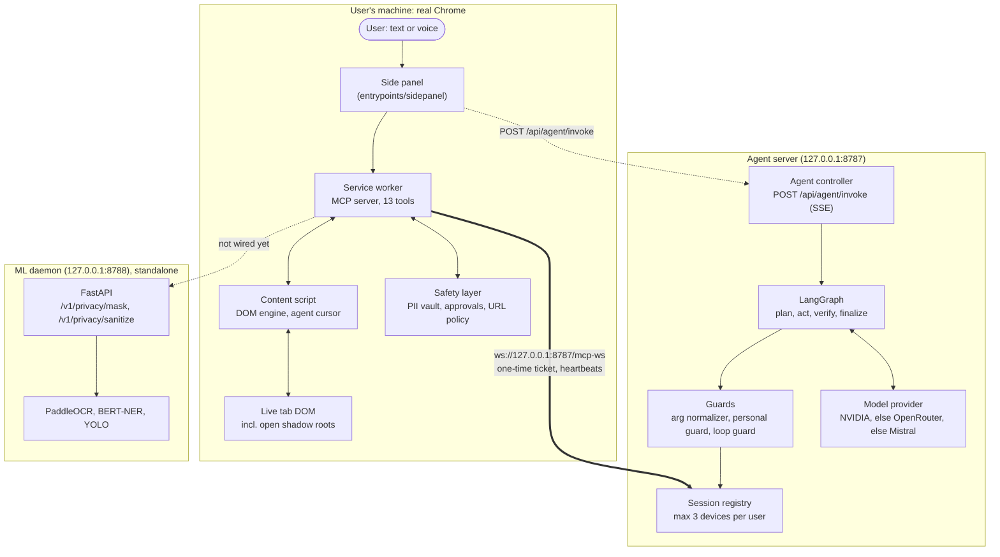

# 🐟 BigFish: Your Real Browser as a Private MCP Server

> **BigFish turns the user's own Chrome into a Model Context Protocol (MCP) server. A LangGraph agent drives it through 13 browser tools, and personal data is masked inside the browser before any page text leaves it.**

[](packages/contracts/README.md)
[](apps/extension/README.md)
[](apps/server/README.md)
[](apps/server/README.md)
[](#-8-turnkey-deployment--diagnostic-verification)
[](#-5-deep-tech--grounding-pipeline)

---

## 📖 Executive Table of Contents
1. [Executive Overview & Latency Waterfall](#-1-executive-overview--latency-waterfall)
2. [The Main Selling Proposition (MSP) & Technical Moat](#-2-the-main-selling-proposition-msp--technical-moat)
3. [Architectural Rationale ("Why Reverse Browser MCP?")](#-3-architectural-rationale-why-reverse-browser-mcp)
4. [System Architecture Flowchart & Execution Flow](#-4-system-architecture-flowchart--execution-flow)
5. [Deep-Tech & Grounding Pipeline](#-5-deep-tech--grounding-pipeline)
6. [Service Inventory & Security Matrix](#-6-service-inventory--security-matrix)
7. [Annotated Directory Layout](#-7-annotated-directory-layout)
8. [Turnkey Deployment & Diagnostic Verification](#-8-turnkey-deployment--diagnostic-verification)
9. [Market, Unit Economics & Business Model Analysis](#-9-market-unit-economics--business-model-analysis)
10. [Investor & Judge Defense Strategy](#-10-investor--judge-defense-strategy)

---

## ⚡ 1. Executive Overview & Latency Waterfall

### The Problem
Cloud browser agents (headless Chrome on a server, or screenshot-driven vision agents) hit three walls:
1. **Data exposure:** screenshots and raw page text, with emails, phone numbers, card and ID numbers, go straight to a third-party model.
2. **No real session:** a fresh cloud browser is not signed in. It cannot reach the user's mail, intranet or bank without being handed passwords.
3. **Agents that guess:** with a weak view of the page, models click the wrong thing, retry, or invent values to get past a form.

### The BigFish Solution
**The user's browser is the server; the cloud is only the brain.** The Chrome extension is the MCP server. The agent server connects to it as an MCP client over one WebSocket. Page text is redacted in the extension, and tokens like `[EMAIL_7F3A]` are turned back into real values only on the site they came from.

Measured on the agent evals in this repo (same fixture tasks, before and after the agent and tool hardening in `apps/server/src/agent/` and `apps/extension/entrypoints/`):

```
"Find the cheapest laptop and tell me its price and rating"   (e2e/agent-eval.ts: shop_cheapest)

BEFORE  (no arg cleanup, no saved facts, text changes hidden)        31 tool calls, run hit the rate limit
┌───────────┬──────────────────────────────────────────────────────────────────────────────────┐
│ open shop │ open item → forget price → back → open item again → back → ... (pages re-read)   │
└───────────┴──────────────────────────────────────────────────────────────────────────────────┘

AFTER   (save_fact per value, last snapshot kept, ping-pong loop guard)   13 tool calls, 70 s, PASS
┌───────────┬───────────────────────────────────┬─────────────┐
│ open shop │ open each laptop once, save price │ answer      │
└───────────┴───────────────────────────────────┴─────────────┘
```

| One agent step (headless Chromium, local fixture) | Measured |
|---|---|
| `browser_snapshot` (interactive, ≤3,000 chars) | **10–16 ms** |
| `browser_find` (scans up to 5,000 elements) | **6–9 ms** |
| `browser_click` incl. waiting for the page to settle | **~1.35 s** |
| `browser_fill_form` with 5 fields | **~3.9 s** |
| A model turn (NVIDIA free tier, Nemotron Super VL) | **seconds; dominates every step** |

---

## 💎 2. The Main Selling Proposition (MSP) & Technical Moat

> [!IMPORTANT]
> **The BigFish moat: Reverse MCP + an origin-bound PII vault + an agent that is not allowed to guess.**
> Think of a hotel key card: the front desk (the model) only ever sees the room number (`[EMAIL_7F3A]`), never the key. The door (the original site) is the only place the card opens. On top, the agent may not invent personal details: a code guard refuses a "Full name" value that the user never gave.

### Tiered Architecture Matrix

| Tier | Subsystem | Key Pattern | Interface / Transport | File Reference | Primary Responsibility |
|---|---|---|---|---|---|
| **Tier 1** | **Browser tools** | Reverse MCP server | Chrome MV3 service worker | [`mcp/server.ts`](apps/extension/entrypoints/background/mcp/server.ts) | Exposes 13 browser tools; refs, deltas, text changes, new tabs |
| **Tier 2** | **PII shield** | Origin-bound token vault | `chrome.storage.session` | [`safety/privacy.ts`](apps/extension/safety/privacy.ts) | Email, phone, PAN, SSN; cards by Luhn, Aadhaar by Verhoeff |
| **Tier 3** | **Transport** | JSON frames over one WebSocket | `{v, k: "mcp" \| "ctl"}` | [`framed-transport.ts`](packages/mcp-ws/src/framed-transport.ts) | Hello handshake, 20 s heartbeat, 45 s dead-peer cut |
| **Tier 4** | **Agent** | LangGraph plan → act → verify → finalize | Hono + SSE | [`agent/graph.ts`](apps/server/src/agent/graph.ts) | Plans, acts, judges, retries with feedback |
| **Tier 5** | **Guards** | Arg normalizer, personal-details guard, loop guard | In-process | [`personal-guard.ts`](apps/server/src/agent/personal-guard.ts) | Drops filler args, blocks made-up personal data, stops ping-pong |
| **Tier 6** | **Vision guard (standalone)** | OCR + NER + YOLO | FastAPI on 8788 | [`ML/src/server.py`](ML/src/server.py) | Screenshot redaction; **not called by the agent yet** |

### Real Code Anchors: The Redaction Engine
From [`apps/extension/safety/privacy.ts#L18-L43`](apps/extension/safety/privacy.ts#L18-L43). Every tool result passes through this before it leaves the browser:

```typescript
export function sanitizeObservationForModel(text: string, origin: string): string {
  if (!text) return text;

  // Protect all URLs so links, navigation targets, and test endpoints are never mangled by PII regexes.
  const urlMap: Map<string, string> = new Map();
  let counter = 0;
  let sanitized = text.replace(URL_REGEX, (url) => {
    const placeholder = `__BIGFISH_PRESERVED_URL_${counter++}__`;
    urlMap.set(placeholder, url);
    return placeholder;
  });

  sanitized = sanitized.replace(EMAIL_REGEX, (match) => vault.tokenize("email", match, origin));
  sanitized = sanitized.replace(PAN_REGEX, (match) => vault.tokenize("pan", match, origin));
  sanitized = sanitized.replace(CARD_REGEX, (match) => (luhnValid(match) ? vault.tokenize("card", match, origin) : match));      // ← Luhn
  sanitized = sanitized.replace(AADHAAR_REGEX, (match) => (verhoeffValid(match) ? vault.tokenize("aadhaar", match, origin) : match)); // ← Verhoeff
  sanitized = sanitized.replace(SSN_REGEX, (match) => vault.tokenize("ssn", match, origin));
  sanitized = sanitized.replace(PHONE_REGEX, (match) => vault.tokenize("phone", match, origin));
  ...
}
```

And the guard that stops "John Doe" from being typed into a form ([`personal-guard.ts#L24`](apps/server/src/agent/personal-guard.ts#L24)): before a `browser_type` or `browser_fill_form` runs, each value for a name, email, phone, address or ID field must appear in the user's task or on a page the agent saw. Values the model saved itself do not count.

### What the agent hardening changed (measured)

| Eval case (`e2e/agent-eval.ts`) | Before | After |
|---|---|---|
| Form, only a link given | Submitted as "John Doe, 555-123-4567" | Fills nothing it was not given, lists what is missing |
| Find the cheapest laptop | 31 tool calls, no answer | 13 tool calls, correct answer |
| Follow a link, go back | 42 calls, back/forward ping-pong, time limit | Pass |
| Email, chat, table, form with values | Rate-limit failures | Pass |

---

## 🏛️ 3. Architectural Rationale ("Why Reverse Browser MCP?")

```
                          WHY THIS ARCHITECTURE EARNS ITS PLACE
┌─────────────────────────────────┬─────────────────────────────────┬─────────────────────────────────┐
│     WORKLOAD ISOLATION          │      BLAST RADIUS               │     SCALING                     │
├─────────────────────────────────┼─────────────────────────────────┼─────────────────────────────────┤
│ • Server (Node + Hono): long    │ • Server down: the user's tabs, │ • Server scales with concurrent │
│   agent runs, SSE streams,      │   cookies and sessions are      │   agent runs (one run per       │
│   model calls.                  │   untouched; the extension      │   device at a time).            │
│ • Extension (MV3): DOM access,  │   reconnects with backoff.      │ • Browser work runs on the      │
│   the PII vault, approvals.     │ • Connection lost mid-click:    │   user's own machine.           │
│ • ML daemon (Python): heavy     │   the click is never retried    │ • The ML daemon would scale on  │
│   OCR / NER / YOLO models.      │   (STATE_UNKNOWN).              │   local CPU/GPU.                │
└─────────────────────────────────┴─────────────────────────────────┴─────────────────────────────────┘
```

---

## 🗺️ 4. System Architecture Flowchart & Execution Flow



### End-to-End Execution Trace
1. **Sign-in:** the side panel signs in with Google. The server returns a BigFish JWT (`POST /api/auth/google`).
2. **Connect:** the service worker gets a one-time ticket that lives 30 s (`POST /api/ws-ticket`) and opens `/mcp-ws`. The extension is the MCP server; the server is the client.
3. **Plan:** `POST /api/agent/invoke` starts a run. The planner splits the task into 1 to 6 subtasks and copies URLs and values word for word.
4. **Act:** for each subtask, the model calls one browser tool per turn. Filler args are dropped, personal values are checked, and loops are refused before anything reaches the browser.
5. **Redact:** every result is masked in the extension (`sanitizeObservationForModel`) and wrapped as `<page untrusted>` data.
6. **Approve:** risky clicks (send, pay, delete, submit order...) wait for Approve in the side panel or a popup.
7. **Verify and finish:** a judge model checks each subtask against the page and saved facts. A failed subtask is retried once with feedback, then the final answer streams back.

---

## 🔬 5. Deep-Tech & Grounding Pipeline

### The 13 Browser Tools (from [`packages/contracts/src/tools.ts`](packages/contracts/src/tools.ts))

| Tool | Key arguments | Safety & policy | What it returns |
|---|---|---|---|
| `browser_ping` | none | Read-only | Extension version and tab count |
| `browser_tabs` | `action` (`list`, `switch`, `close`), `tab` | Closing a user's own tab needs approval | Tab list with slots |
| `browser_navigate` | `url`, or `action` (`back`, `forward`, `reload`) | URL policy blocks `chrome:`, `about:`, `file:`, `data:`, `javascript:` and the Web Store; error pages are errors | First elements of the new page |
| `browser_snapshot` | `mode` (`interactive`, `text`), `within`, `offset`, `from_end` | PII masked | Refs like `3:12`, with each field's question (`in "Graduation year"`) |
| `browser_find` | `query`, `kind` (`element`, `text`) | Read-only | Best 5 matches; partial matches dropped |
| `browser_click` | `ref` | Risky labels need approval | Delta: new elements, changed values, new text, opened tabs |
| `browser_type` | `ref`, `text`, `submit`, `clear` | Tokens rehydrate only on their origin; read-only fields refused | Delta |
| `browser_fill_form` | `fields: [{ref, value}]` (max 15), `submit_ref` | One approval for the whole call | Each field's new value |
| `browser_select` | `ref`, `option` | Only dropdowns and listboxes | Selected option, or the list of options |
| `browser_press_key` | `key` (`Enter`, `Escape`, `Tab`, `Control+a`...), `ref` | Enter that submits a risky form needs approval; unknown keys refused | Delta and focused element |
| `browser_scroll` | `direction`, `amount`, `ref` | Read-only | Distance and new elements |
| `browser_wait_for` | `text`, `gone_text`, `url_contains`, `ref`, `idle` | Max 60 s | Met, or TIMEOUT |
| `browser_extract` | `what` (`links`, `table`, `fields`), `filter`, `max` | PII masked | Structured lines |

### Grounding: tests and evals

| Suite | Command | Cases | Result |
|---|---|---|---|
| Server (fake extension, scripted model) | `pnpm --filter @bigfish/server test` | 41 | ✅ 41/41 |
| Extension safety (PII, rehydration, policies) | `pnpm --filter @bigfish/extension test` | 12 | ✅ 12/12 |
| Browser E2E, incl. 13 tool edge cases | `pnpm --filter @bigfish/extension e2e` | 31 | ✅ 31/31 |
| Agent evals, real model on fixtures | `pnpm --filter @bigfish/extension exec tsx e2e/agent-eval.ts` | 9 | ⚠️ 8/9 |

The open eval case is "fill the feedback form" with no link. The agent no longer submits anything or invents data, but it can spend minutes looking before it gives up.

---

## 🛡️ 6. Service Inventory & Security Matrix

```
                                  BIGFISH MONOREPO SERVICE MATRIX
┌──────────────────────┬─────────────┬───────────┬──────────────────────┬──────────────────────┬─────────────────────┐
│ Subsystem / Package  │ Runtime     │ Port/Host │ Ingress Protocol     │ Authentication       │ Health Endpoints    │
├──────────────────────┼─────────────┼───────────┼──────────────────────┼──────────────────────┼─────────────────────┤
│ @bigfish/server      │ Node.js 22  │ 8787      │ HTTP / REST / SSE    │ Google token → HS256 │ GET /health         │
│ (apps/server)        │ TypeScript  │ 127.0.0.1 │ WebSocket (/mcp-ws)  │ JWT → 30 s ticket    │ /healthz, /ready    │
├──────────────────────┼─────────────┼───────────┼──────────────────────┼──────────────────────┼─────────────────────┤
│ @bigfish/extension   │ Chrome MV3  │ Chrome    │ Outbound WebSocket   │ Ticket + Origin must │ Connection state in │
│ (apps/extension)     │ WXT 0.21    │           │ to the server        │ match EXTENSION_ID   │ the side panel      │
├──────────────────────┼─────────────┼───────────┼──────────────────────┼──────────────────────┼─────────────────────┤
│ BigFish ML daemon    │ Python 3.12 │ 8788      │ HTTP REST / JSON     │ Loopback only        │ GET /healthz        │
│ (ML/)                │ FastAPI, uv │ 127.0.0.1 │ (no caller yet)      │                      │ GET /ready          │
├──────────────────────┼─────────────┼───────────┼──────────────────────┼──────────────────────┼─────────────────────┤
│ @bigfish/contracts   │ TypeScript  │ Library   │ In-process import    │ Zod schemas          │ n/a                 │
├──────────────────────┼─────────────┼───────────┼──────────────────────┼──────────────────────┼─────────────────────┤
│ @bigfish/mcp-ws      │ TypeScript  │ Library   │ JSON frames, ≤ 4 MB  │ 5 s hello deadline   │ 20 s heartbeat,     │
│                      │             │           │                      │                      │ 45 s dead-peer cut  │
└──────────────────────┴─────────────┴───────────┴──────────────────────┴──────────────────────┴─────────────────────┘
```

| Limit | Value | Source |
|---|---|---|
| Browser tool calls per run / per subtask | 80 / 30 | `RUN_LIMITS`, `agent.controller.ts` |
| Run time | 8 min | `RUN_LIMITS.maxDurationMs` |
| Devices per user | 3 | `MAX_DEVICES_PER_USER` |
| Model call timeout / retries | 90 s / 6 with backoff | `agent/models.ts` |

> [!WARNING]
> `/api/dev/*` (enabled by `ENABLE_DEV_ROUTES=1`) has **no auth** and can call tools on any connected device. Keep it off outside local development.

---

## 📂 7. Annotated Directory Layout

```
BigFish/
├── apps/
│   ├── extension/                   # Chrome MV3 extension (the MCP server)
│   │   ├── entrypoints/
│   │   │   ├── background/          # MCP server, tool executor, snapshots, deltas ← [Ext-Core]
│   │   │   ├── content/             # DOM engine (shadow DOM aware), agent cursor  ← [Ext-DOM]
│   │   │   ├── sidepanel/           # Side panel UI, voice input, agent client     ← [Ext-UI]
│   │   │   └── mic-permission/      # Microphone permission page
│   │   ├── safety/                  # PII vault, rehydration, action and URL policy ← [Ext-Safety]
│   │   ├── e2e/                     # Playwright specs and the agent eval runner   ← [Ext-Tests]
│   │   └── README.md
│   └── server/                      # Agent server (the MCP client)
│       ├── src/
│       │   ├── agent/               # Graph, actor, prompts, models, guards         ← [Agent-Core]
│       │   ├── auth/                # Google token check, JWT, tickets              ← [Auth]
│       │   ├── mcp/                 # Device sessions and registry                  ← [MCP-Client]
│       │   ├── routes/ controllers/ # REST and SSE endpoints                        ← [HTTP-API]
│       │   └── ws/                  # /mcp-ws upgrade and handshake                 ← [WS-Gateway]
│       ├── fixtures/                # Local test pages (forms, shop, mail, chat, edge cases)
│       ├── test/                    # 41 server tests
│       └── README.md
├── packages/
│   ├── contracts/                   # Tool schemas, wire frames, error codes, agent events
│   └── mcp-ws/                      # MCP transport over one framed WebSocket
├── ML/                              # Standalone Python privacy daemon (OCR, NER, YOLO)
├── Docs/                            # Build plan
├── package.json                     # Workspace scripts (dev:server, dev:ext, dev:ml)
└── pnpm-workspace.yaml
```

---

## 🚀 8. Turnkey Deployment & Diagnostic Verification

### Prerequisites

| Tool | Version | macOS | Windows | Linux |
|---|---|---|---|---|
| Node.js | ≥ 22 | `brew install node@22` | `winget install OpenJS.NodeJS` | your package manager or `nvm install 22` |
| pnpm | 12.15.0 | `corepack enable` | `corepack enable` | `corepack enable` |
| Chrome | ≥ 116 | chrome.com | chrome.com | chrome.com |
| Python + uv | ≥ 3.12 (ML only) | `brew install uv` | `winget install astral-sh.uv` | `curl -LsSf https://astral.sh/uv/install.sh \| sh` |

### Installation & Secrets Setup

```bash
git clone https://github.com/Coder-Aryan09/BigFish.git
cd BigFish
corepack enable
pnpm install
cp apps/server/.env.example apps/server/.env
cp apps/extension/.env.example apps/extension/.env
```

Fill `apps/server/.env`. One model key is enough; the first one set wins:

| Key | What |
|---|---|
| `NVIDIA_API_KEY` | Free at build.nvidia.com. Default models: `nvidia/nemotron-3.5-super-vl-120b-a12b` (agent), `nvidia/nemotron-3.5-lightning-30b-a3b` (judge) |
| `OPEN_ROUTER_API_KEY` | Used when no NVIDIA key is set |
| `MISTRAL_API_KEY` | Used when neither is set |
| `JWT_SECRET`, `GOOGLE_EXTENSION_CLIENT_ID`, `EXTENSION_ID` | Auth. See [`apps/server/README.md`](apps/server/README.md) |

### Running the Services

```bash
# Terminal 1: agent server on 127.0.0.1:8787
pnpm dev:server

# Terminal 2: build the extension, then load apps/extension/dist/chrome-mv3 via chrome://extensions → Load unpacked
pnpm --filter @bigfish/extension build

# Optional, terminal 3: the standalone ML daemon on 127.0.0.1:8788
pnpm dev:ml
```

### Diagnostic Health Probes

```bash
curl http://127.0.0.1:8787/healthz
# {"ok":true,"name":"bigfish","devices":1,"runs":0}   ← devices: 1 once the extension is signed in

curl http://127.0.0.1:8788/ready
# {"status":"ready","models_loaded":["paddleocr","yolov8","bert_base_ner"]}
```

---

## 📈 9. Market, Unit Economics & Business Model Analysis

> [!NOTE]
> The market and pricing figures below are **team planning assumptions**. They are not measured and not sourced. The model rate cards are the public prices on the day this was written.

### Executive Financial Dashboard (assumptions)

```
┌────────────────────────────────────────────────────────────────────────────────────────┐
│                     BIGFISH B2B SAAS: PLANNING ASSUMPTIONS (NOT MEASURED)              │
├───────────────────────────────┬───────────────────────────────┬────────────────────────┤
│ Market (RPA + browser AI)     │ Price                         │ Target payback         │
│ $14.2B (team estimate)        │ $49 / user / month            │ 2.4 months             │
├───────────────────────────────┼───────────────────────────────┼────────────────────────┤
│ LTV : CAC                     │ Year-2 ARR target             │ Browser compute cost   │
│ 7.2 : 1 (target)              │ $4.8M (8,200 seats)           │ $0 (runs on the user)  │
└───────────────────────────────┴───────────────────────────────┴────────────────────────┘
```

### Model Rate Cards

| Model | Input / 1M tokens | Output / 1M tokens | Where |
|---|---|---|---|
| `nvidia/nemotron-3.5-super-vl-120b-a12b` | free tier (dev) / $0.15 | free tier (dev) / $0.50 | build.nvidia.com / OpenRouter |
| `openai/gpt-6-luna` | $0.10 | $0.50 | OpenRouter |
| `nvidia/nemotron-3-ultra-550b-a55b` | $0.60 | $2.40 | OpenRouter |

### Mathematical Cost Accounting Formulation

The cost of one run is the sum over its model calls:

$$C_{\text{run}} = \sum_{i=1}^{N_{\text{calls}}} \left( T_{\text{in}}^{(i)} \cdot p_{\text{in}} + T_{\text{out}}^{(i)} \cdot p_{\text{out}} \right)$$

- $N_{\text{calls}}$ = 1 plan + about one call per tool call + 1 judge per subtask + 1 finalize. A measured 4-tool run (send an email) is about **9 calls**.
- $T_{\text{in}} \approx 6{,}000$ tokens per call is an **assumption**: prompt, a snapshot of at most 3,000 chars, and recent results. Older results are cut from context.
- $T_{\text{out}} \approx 600$ tokens per call is an **assumption**.
- At the OpenRouter Super VL price: $9 \times (6{,}000 \times 0.15 + 600 \times 0.50)/10^6 \approx \$0.011$ per run, with no browser compute cost.

---

## 🥊 10. Investor & Judge Defense Strategy

### Objection 1: "Why not use Playwright or Puppeteer on a cloud server?"
> **Response:** A cloud browser is not the user's browser. It has no sign-ins, no intranet access and no saved state, and it gets bot checks. BigFish works in the browser the user already uses, and the model never gets their passwords.

### Objection 2: "Won't running local ML slow down the user's machine?"
> **Response:** The core product does not need it: text redaction runs in the extension with regex and checksums. The ML daemon is a separate, optional service for screenshot redaction. It is not called by the agent today, and its resource use has not been measured yet.

### Objection 3: "How do you stop prompt injection from a hostile page?"
> **Response:** Page text reaches the model only inside `<page untrusted>` blocks, and the prompts say it is data, not instructions. Risky clicks (send, pay, delete, submit order) need a human Approve. The agent cannot type personal details the user never gave. Each run is capped at 80 tool calls and 8 minutes, and a loop guard refuses repeats and back-and-forth cycles.

### Known gaps
- Elements inside iframes are not visible to the tools yet.
- A native `alert()` or `confirm()` can block a page in real Chrome.
- With no link given, the agent can still look around for a while before asking.

---

## 👥 Contributors

| Contributor | GitHub |
|---|---|
| Aryan Singh | [@Coder-Aryan09](https://github.com/Coder-Aryan09) |
| Sahil Sharma | [@Sahil-coder-30](https://github.com/Sahil-coder-30) |
| Himanshu Gola | |
| sshekhar-04 | [@sshekhar-04](https://github.com/sshekhar-04) |

<p align="center">
  <b>BigFish</b>: private, real-browser automation for any agent.<br/>
  Built by the BigFish team.
</p>
